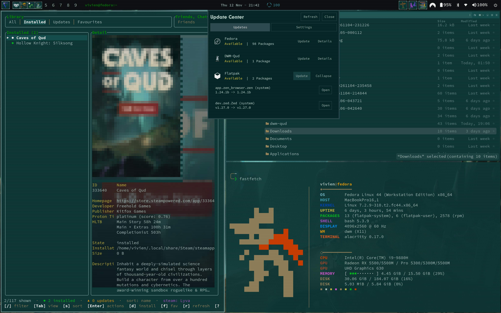
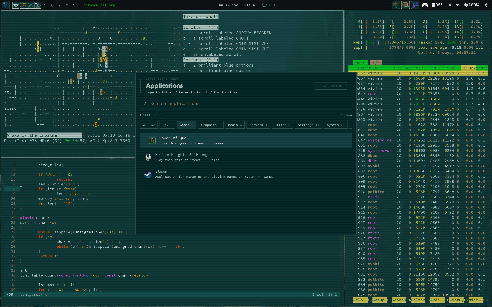

# dwm-qud

A customised fork of [dwm](https://dwm.suckless.org/), featuring a [Caves of Qud](https://cavesofqud.com/) inspired aesthetic, configurable window styling and a lightweight X11 desktop environment.

## Installation

```bash
git clone https://github.com/lyrashmi/dwm-qud.git
cd dwm-qud
./install.sh
```

## Screenshots





## Configuration

Appearance settings can be customised in:

`config/themes.toml`

## Building

Build dependencies include a C compiler, `make`, X11 development libraries and the required pkg-config packages.

```bash
make
sudo make install
```

## Release

**Current version:** v0.2.0

[View releases](https://github.com/lyrashmi/dwm-qud/releases)
